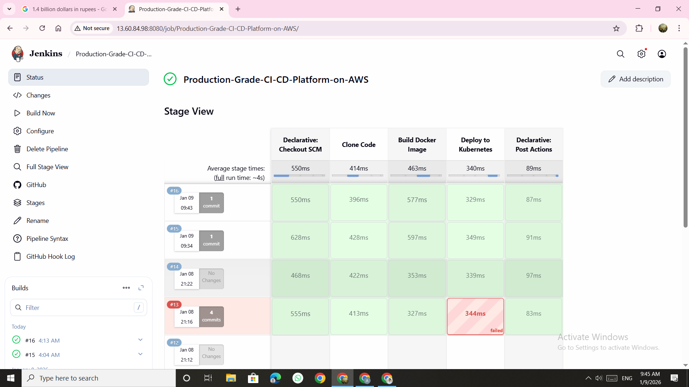
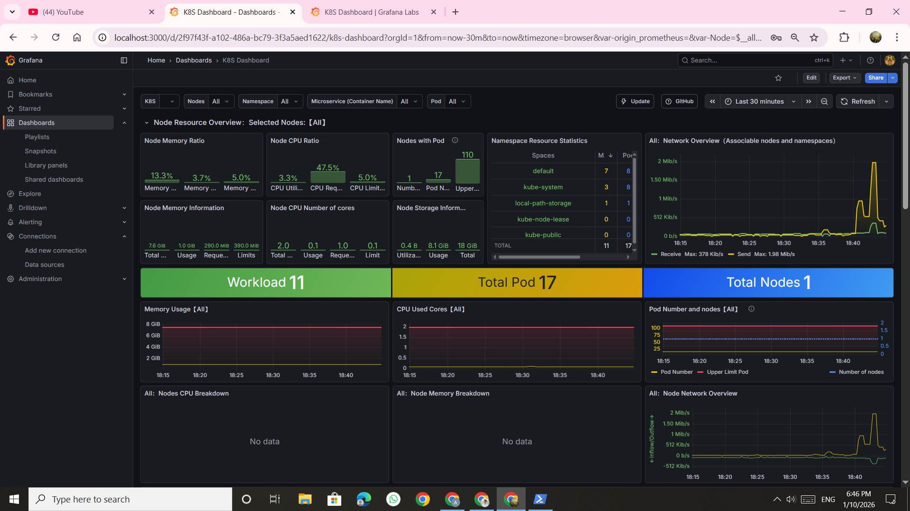
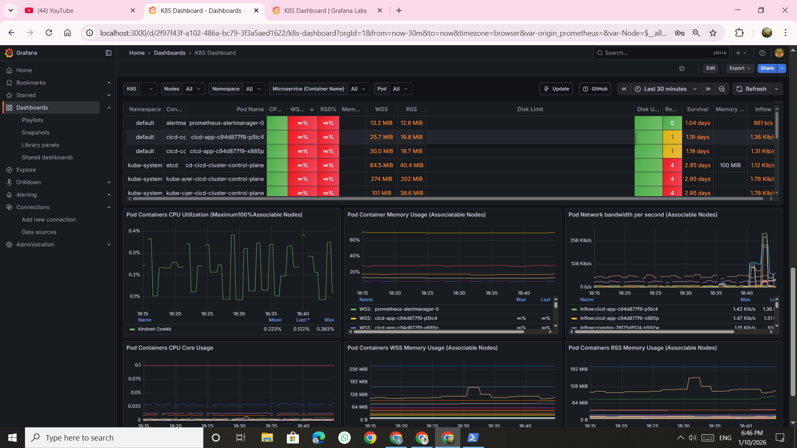
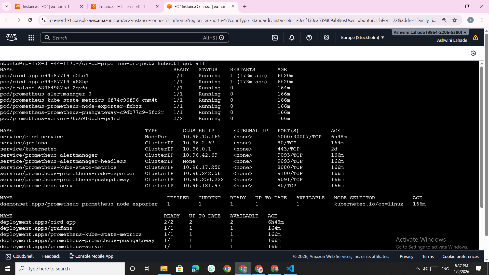

# 🚀 Production-Grade CI/CD Platform on AWS

## Project Overview
Designed and implemented a production-grade CI/CD pipeline using Jenkins, Docker, Kubernetes, and AWS. The pipeline automates build, deployment, rollback, and monitoring of a containerized application.

---

## 🛠️ Tech Stack
- Cloud: AWS EC2
- CI/CD: Jenkins (Pipeline as Code)
- Containers: Docker
- Orchestration: Kubernetes (KIND)
- Monitoring: Prometheus, Grafana
- SCM: GitHub
- OS: Linux (Ubuntu)

---

## ⚙️ Architecture
GitHub → Jenkins → Docker → Kubernetes → Monitoring

---

## 🔁 CI/CD Workflow
1. Code push to GitHub
2. Jenkins pipeline triggered via webhook
3. Docker image built automatically
4. Image deployed to Kubernetes
5. Rolling updates with rollback support
6. Application monitored using Prometheus & Grafana

---

## ☸️ Kubernetes Features
- RollingUpdate strategy
- Readiness & Liveness probes
- Self-healing pods
- NodePort & port-forwarding
- Rollback using `kubectl rollout undo`

---

## 📊 Monitoring
- Prometheus for metrics collection
- Grafana dashboards for visualization
- Pod-level CPU & memory monitoring

---

## 📸 Screenshots
## Jenkins pipeline Dashboard

## Monitoring Dashboard

## Kubernetes Status

---

## 🧠 Key Learnings
- CI/CD pipeline automation
- Kubernetes deployment strategies
- Debugging image pull & rollout issues
- Secure access using SSH tunneling
- Production-level monitoring setup

---

## ✅ Status
Project completed and production-ready 🚀
